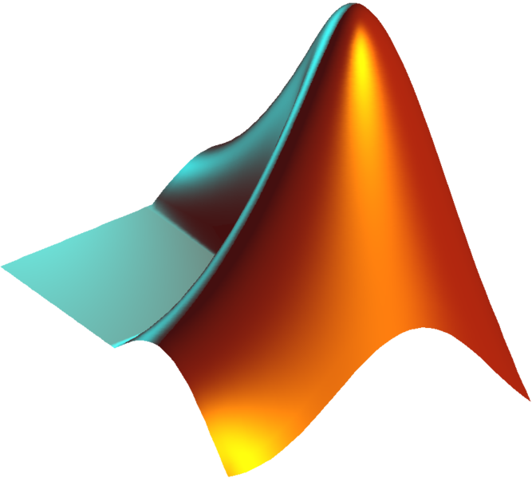
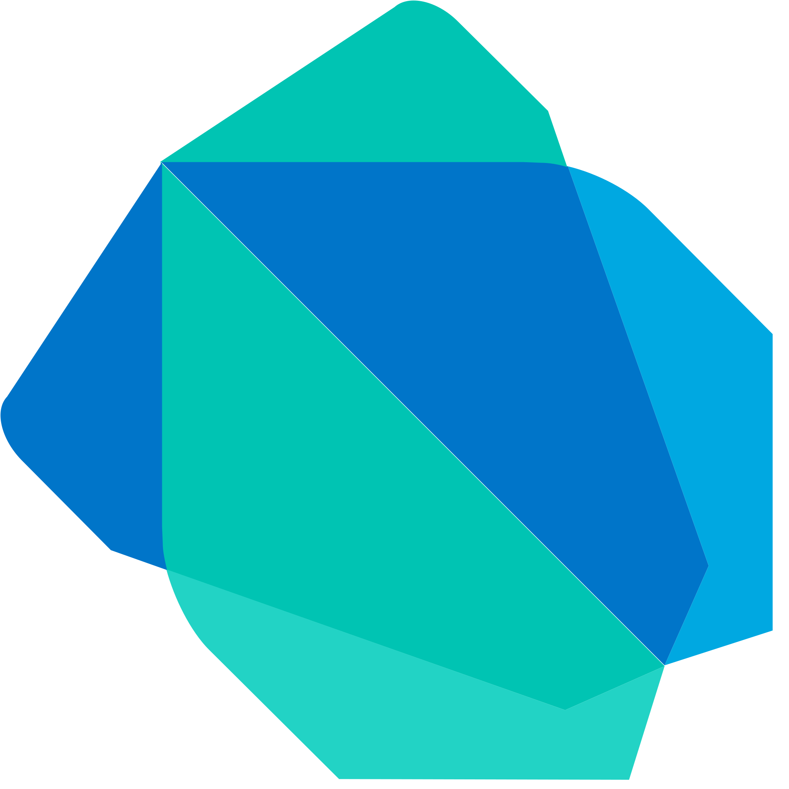
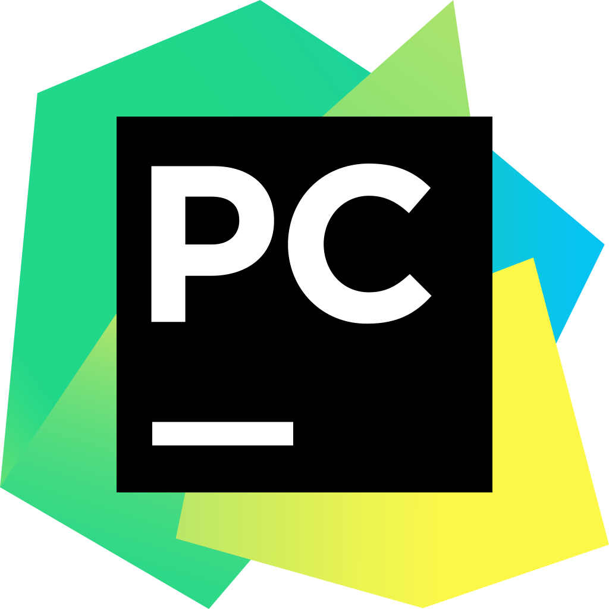
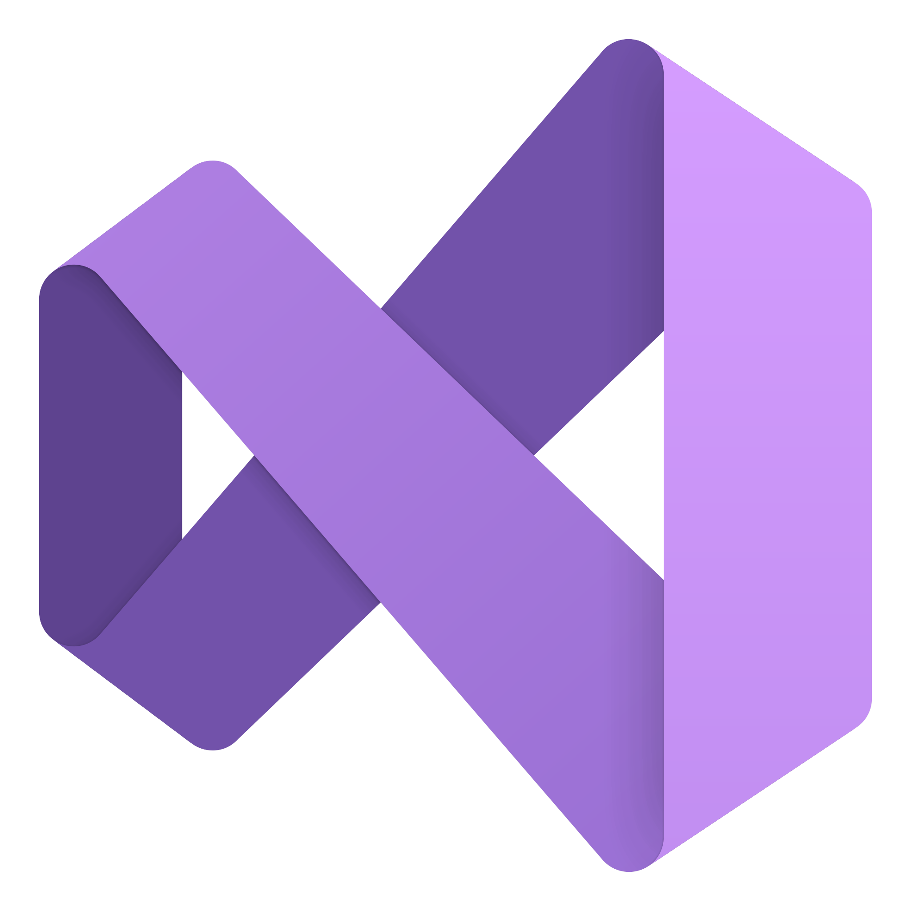
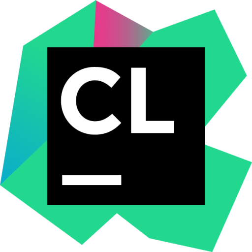
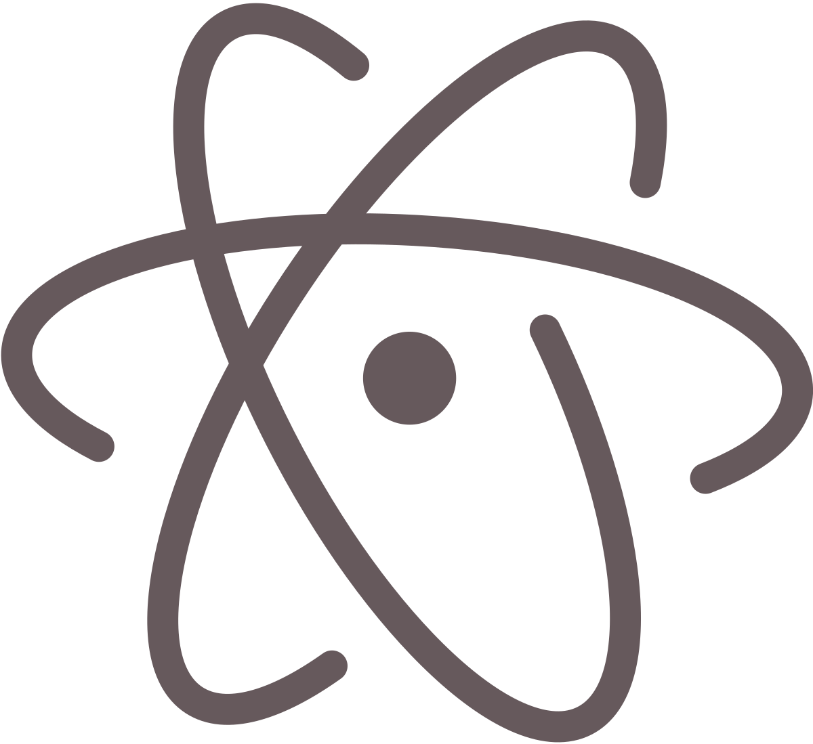
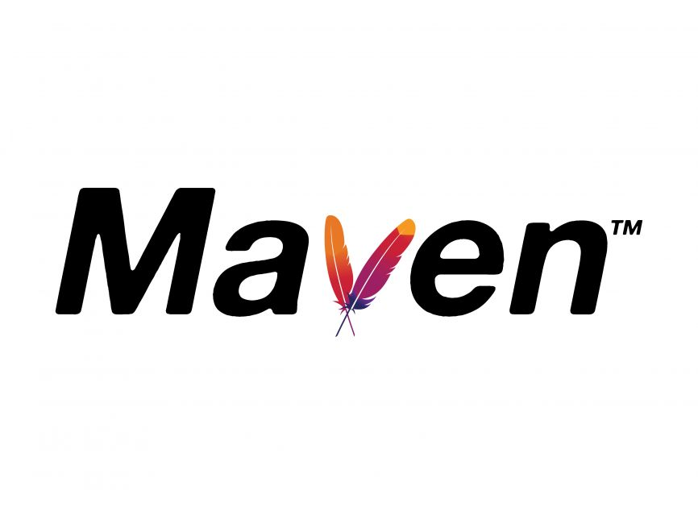
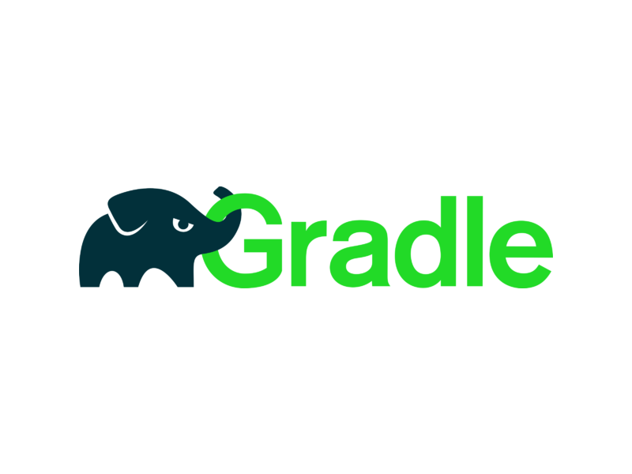

 

&nbsp;

 

<h2>⚒️ Technical Toolbox</h2>

<h4>Programming Languages</h4>

<h4>Development Environments</h4>

<h4>Frameworks & Interfaces</h4>

<h4>Databases & Platforms</h4>

<h2>📊 GitHub Activity</h2>

