

<h2>Saba Madadi</h2>

  

  

  

<h2>⚒️ My Toolbox</h2>

PROGRAMMING LANGUAGES

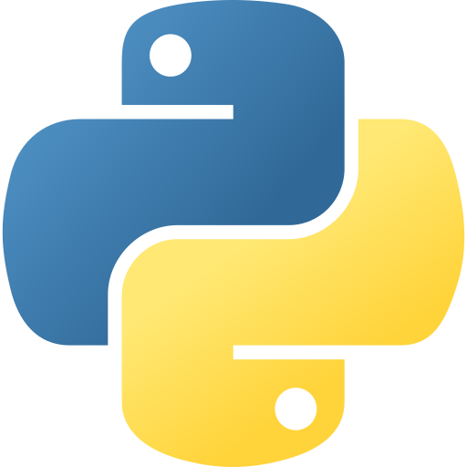

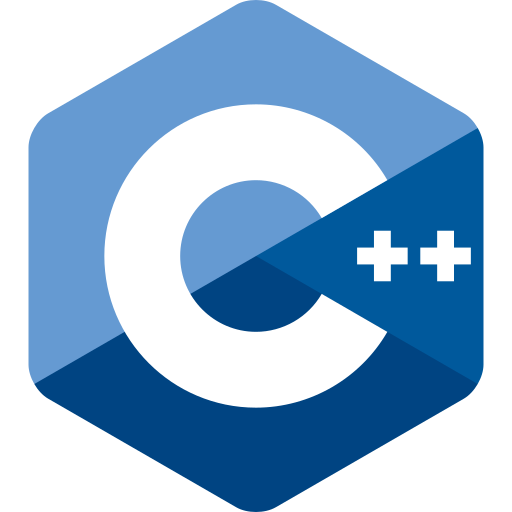
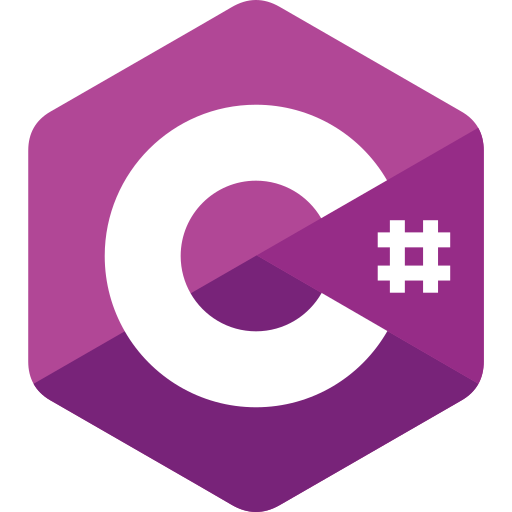
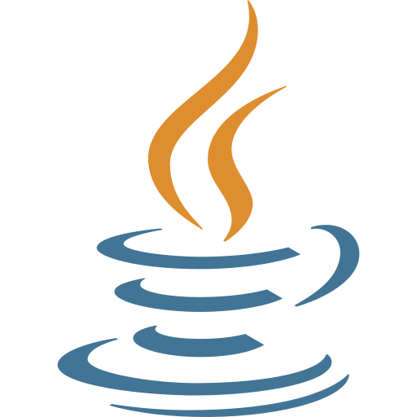

  

DEVELOPMENT ENVIRONMENTS

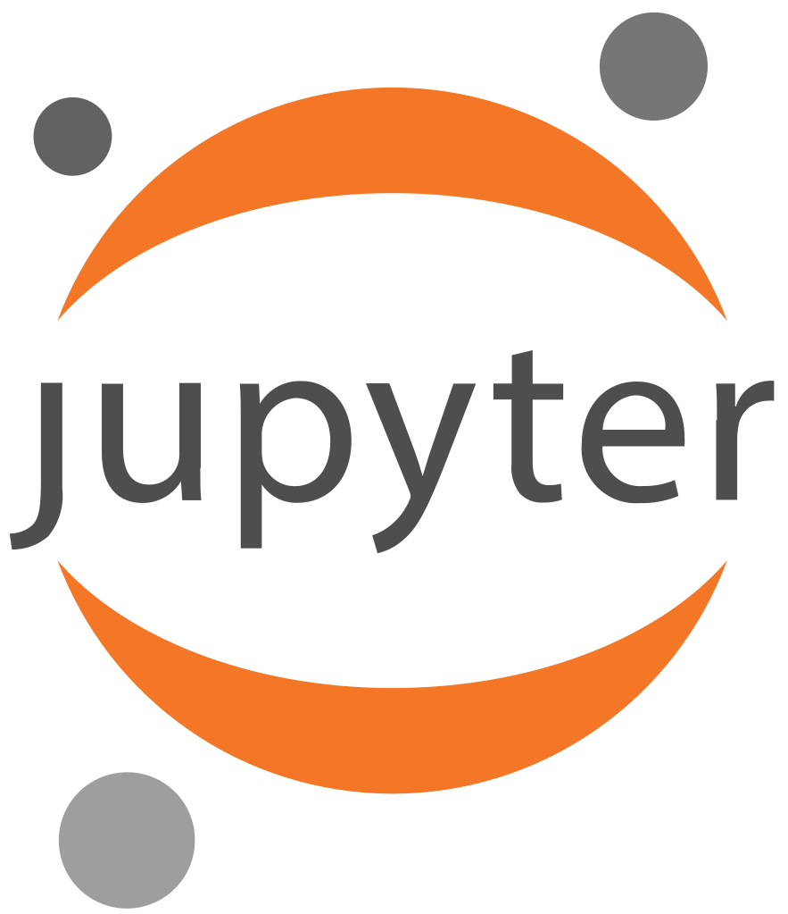

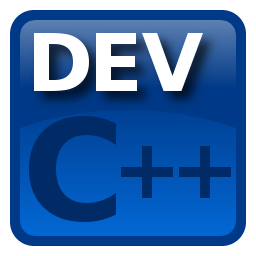
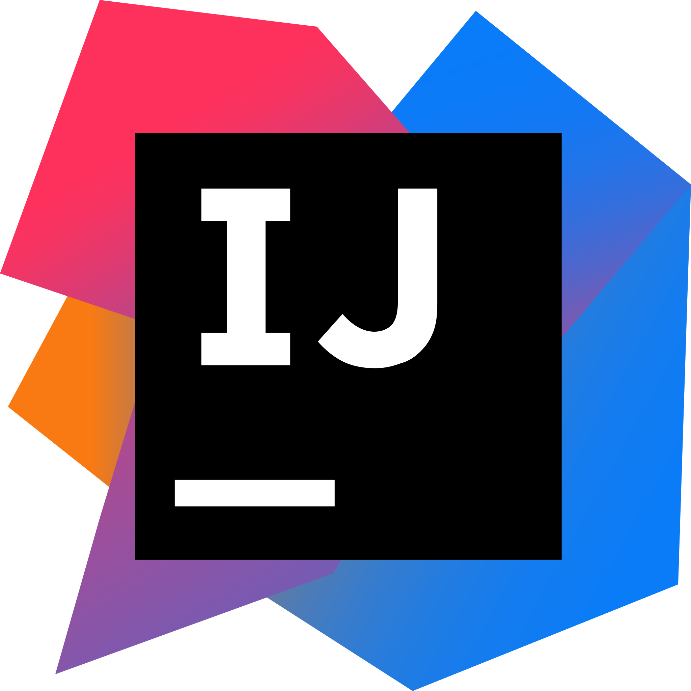

  

FRAMEWORKS & INTERFACES

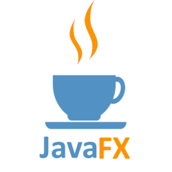
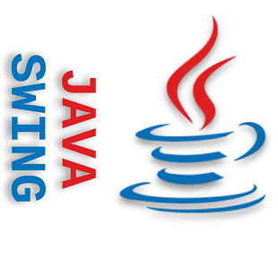

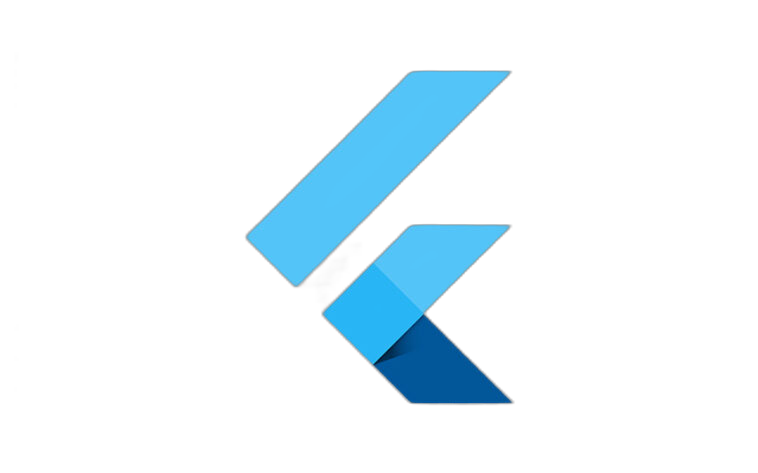

  

DATABASES & OTHER TOOLS

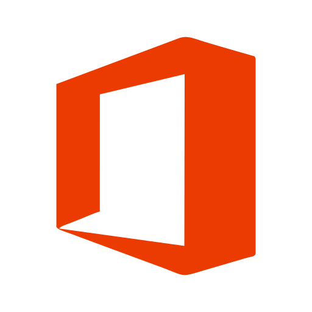

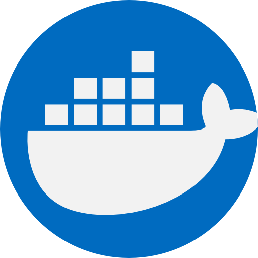

  

<h2>📊 GitHub Activity</h2>

  

